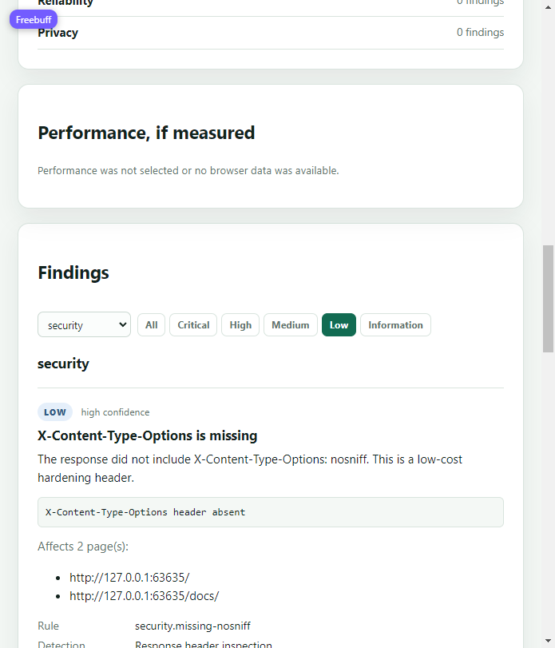
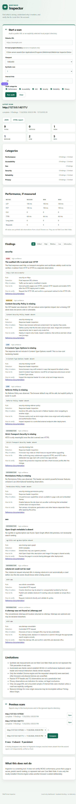

# Inspector browser and scan validation

Date: **2026-11-07**

## Environment

| Item | Value |
| --- | --- |
| OS | Windows 10.0.26200 |
| Node | v24.19.0 |
| Chrome | Google Chrome **157.0.8103.39** |
| Browser automation | `playwright-core` 1.65.0, installed Chrome executable |
| Accessibility engine | `axe-core` 4.14.0 |
| Fixture | Local controlled server on loopback; no third-party services |
| Dashboard | `http://127.0.0.1:4173`, loopback-only |

No browser was downloaded for Inspector; Playwright-core launches the existing Chrome installation.

## Automated suite

```text
npm test
tests 39
pass 39
fail 0
duration_ms approximately 22 s (Windows, serialized real-browser tests)
```

The tests are serialized because several cases open a real Chrome process. They cover:

- real browser scan of the controlled fixture;
- expected accessibility, SEO, security and reliability findings;
- one and two synthetic-run aggregation;
- browser-level blocking of a metadata subresource;
- default rejection of a local target;
- connection-time lookup, redirects, metadata redirects, response size and timeouts;
- CLI scan, compare, verify and invalid input;
- dashboard token/same-origin behavior and a real local scan;
- report escaping, comparison, fingerprint stability and manifest verification.
- bounded crawl discovery, page/depth limits, robots 4xx/5xx/redirects, sitemap indexes, timeouts,
  cancellation and aggregate findings;
- browser-backed crawl traffic through the loopback validating proxy;
- dashboard site crawl and cancellation.

## Controlled fixture findings

A full scan of `fixtures/site-server.js` at 1440×900 produced **17 findings**:

| Category | Findings | Examples |
| --- | ---: | --- |
| accessibility | 5 | missing alt, missing form label, low contrast, ARIA-hidden focusable control, skipped heading |
| seo | 2 | broken internal link, heading-level skip |
| security | 6 | HTTP target, missing CSP/referrer/permissions/nosniff/HSTS context, cookie SameSite |
| reliability | 4 | JavaScript exception, HTTP 404, zero-size image, MIME mismatch |
| performance | 0 | fast local page; metrics were still recorded |
| privacy | 0 | all resources same-origin in this fixture |

The absence of performance findings is not a failure: the page's lab metrics were under the chosen
thresholds. The dashboard local site produced **9 findings**, predominantly the intentionally absent
security headers and SEO metadata.

## Site crawl real-browser check

A dashboard crawl of `fixtures/local-site` was run in Chrome with all categories, max 3 pages and
depth 2. It completed **2 audited pages**, with **10 aggregate findings**, robots unavailable (the
fixture serves no robots.txt) and a partial fallback sitemap result. The page table showed both pages
as completed; expanding a page showed its individual findings. The category filter reduced the
finding list to `security`, and the severity filter then showed the two low-severity security items.
The JSON export returned `application/json` with `target.scope: "site"`; the HTML export returned
`text/html` and included the site crawl section.



A second local crawl compared against the first produced **0 new, 0 absent, 10 persistent** findings
after page identity was normalized by path. The browser's Freebuff overlay in screenshots is not part
of Inspector.

Starting a larger crawl and pressing **Cancel scan** produced a `partial` report with the message
`Scan cancelled; partial report saved`; the dashboard stopped polling and did not present the scan as
complete.

## Dashboard real-browser check

The dashboard was exercised in Chrome with a local project directory selected through the UI:

- dashboard loaded from `127.0.0.1:4173`;
- form accepted a local project path;
- progress moved through validation/HTTP/browser phases;
- a report rendered with 9 findings;
- severity filtering showed only the High `security.no-https` finding;
- JSON export returned application/json with a 200 response;
- two scans appeared in history;
- compare exposed **0 new, 0 absent, 9 persistent** for the same local project after fingerprints
  were made independent of the ephemeral loopback port.

Evidence:



The screenshot includes the browser's own Freebuff overlay, which is not part of Inspector.

## SSRF fixture

`/ssrf.html` includes both an image and a `fetch()` to
`http://169.254.169.254/latest/meta-data/`. The browser route guard aborted the requests and the
reliability category reported `reliability.blocked-by-policy` with the metadata URL as evidence.

The HTTP client separately rejects:
- direct metadata targets;
- a 302 from a permitted local fixture to a metadata address;
- private ranges, loopback, link-local, IPv6 local/mapped addresses and non-canonical addresses.

## Not verified

- Firefox, Safari, WebKit or a physical mobile device.
- Native Chrome network/CPU throttling.
- Real user field data/CrUX.
- Full keyboard and screen-reader traversal.
- A production HTTPS target or a public deployment.
- End-to-end HTTPS browser traffic through the validating proxy; direct HTTP and CONNECT policy tests
  pass, but there is no controlled TLS fixture.
- Live extension profile comparison; no extension automation is shipped in 0.1.0.
- Conformance, security certification or search-engine indexing.

## Reproduce

```bash
cd "Webtimize Inspector"
npm install
node fixtures/site-server.js
# in another terminal:
node bin/inspector.js scan http://127.0.0.1:4318/ --allow-private \
  --json __development/experiments/full.json --html __development/experiments/full.html
node bin/inspector.js crawl http://127.0.0.1:4318/ --allow-private --max-pages 5 \
  --json __development/experiments/site.json --html __development/experiments/site.html
npm test
node bin/inspector.js dashboard --port 4173
```

The fixture server logs its URL. Raw reports and screenshots in `__development/experiments/` are ignored; curated
evidence is under `evidence/`.
